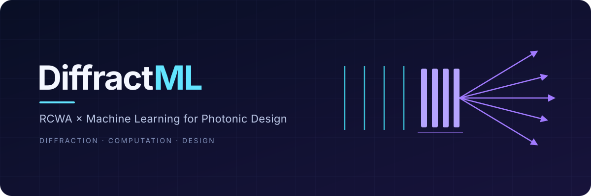

Modeling the optical response of diffractive structures using Rigorous
Coupled-Wave Analysis (RCWA) integrated with Machine Learning. The RCWA engine
is [TORCWA](https://github.com/Alexin-CH/TORCWA) (GPU-accelerated and
differentiable).

## Table of Contents

- [Active project](#active-project)
- [Previous work](#previous-work)
- [Archives](#archives)
- [Getting Started](#getting-started)

## Active project

- **`v7-finite-grating/`** — the project's main aim: approximate the full-wave
  (MEEP FDTD) response of a *finite, defective* 1D grating with fast periodic
  RCWA plus a learned correction. M0 (validated FDTD ground-truth simulator),
  M1 (padded-supercell RCWA benchmark) and M2 (learned spectral correction,
  ~85% lower absorption error on held-out geometries) are complete; Experiment 1
  shows an ideal unit cell at `nh=8` plus the correction matches the padded
  supercell at ~2.9× lower solve cost. See its
  [README](v7-finite-grating/README.md).

## Previous work

- **`v6-inverse-design/`** — physics-informed inverse design of a 1D
  sine-corrugated TiN grating. A neural surrogate predicts the RCWA response,
  then inverse design recovers the grating geometry `(amp, per)` that matches a
  target response spectrum, with optional refinement through the differentiable
  RCWA solver. See its [README](v6-inverse-design/README.md).

## Archives

- **`archives/`** — earlier research versions (v0–v5): hyper-network weight
  prediction, order-convergence extrapolation, etc. Kept for reference; their
  data pipelines contained bugs (e.g. all 32 S-parameter columns identical) that
  are fixed in `v6-inverse-design`.

## Getting Started

### Prerequisites

- [Miniconda](https://docs.conda.io/en/latest/miniconda.html) or Anaconda, with
  `conda` on your `PATH`. If it is installed in a non-standard place (e.g.
  `~/Apps/miniconda3`), load it first:

  ```bash
  source ~/Apps/miniconda3/etc/profile.d/conda.sh
  ```

- `git` and a C/C++ toolchain (MEEP and TORCWA are compiled).
- Optional: a CUDA GPU for RCWA training (CPU works, but is slower).

### Installation

The project uses **two conda environments**, because MEEP and the TORCWA/torch
stack do not coexist cleanly:

| environment | used for |
|---|---|
| `rcwa-v7` | RCWA, training, and every `make` target except `references` |
| `meep-v7` | MEEP FDTD reference generation (`make references`) |

```bash
git clone --recurse-submodules https://github.com/Alexin-CH/DiffractML.git
cd DiffractML

# 1. RCWA / ML environment (needed for everything except MEEP references)
conda env create -f v7-finite-grating/environment-rcwa.yml
conda activate rcwa-v7
pip install -e TORCWA/          # TORCWA is not on PyPI

# 2. FDTD environment (only to regenerate the ground truth)
conda env create -f v7-finite-grating/environment.yml   # creates meep-v7

# 3. verify
make doctor                     # active interpreter and missing packages
make test                       # the v7 test suite
```

`make setup` prints these steps without running anything, and `make install`
is an alias for it.

### Makefile

Each target is run in an activated environment. `PYTHON` defaults to `python3`
of that environment and can be overridden (`make test PYTHON=/path/to/python`).

| target | environment | what it does |
|---|---|---|
| `make doctor` | any | report the interpreter and missing packages |
| `make env-rcwa` / `env-meep` | any | create the conda environments |
| `make torcwa` | `rcwa-v7` | `pip install -e TORCWA/` into the active env |
| `make test` | `rcwa-v7` | run `v7-finite-grating/tests` |
| `make e3` / `e3-scale` | `rcwa-v7` | encoder ladder / sample-efficiency curve |
| `make e4a` / `e4b` / `e4c` | `rcwa-v7` | oracle experiments |
| `make manifest` | `rcwa-v7` | emit the remote MEEP job list |
| `make references` | `meep-v7` | run that job list (104 MEEP runs) |

The v7-specific requirements live in
[`v7-finite-grating/requirements.txt`](v7-finite-grating/requirements.txt); the
root `requirements.txt` is kept for the legacy pip-only path.
